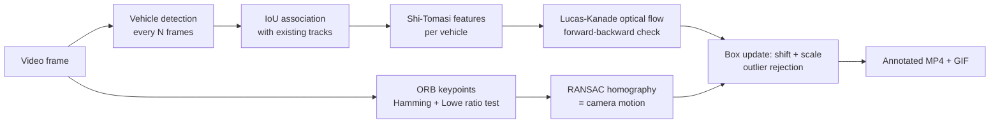

# Classical Vehicle Motion Tracker

Detects vehicles in a video and tracks their frame-by-frame displacement using **classical computer vision**: Lucas-Kanade sparse optical flow, ORB feature matching and RANSAC. Works with **static cameras (CCTV)** and **moving cameras (dashcams)**.


*Boxes = tracked vehicles, label = persistent ID and camera-compensated speed (px/frame), yellow dots = tracked feature points, coloured line = recent trajectory.*

### Demo video

**[▶ Watch the full tracked video](demo_video.mp4)** (opens in GitHub's built-in player)


---

## How it works



| Stage | Technique | Purpose |
|---|---|---|
| Ego-motion | ORB features, Hamming-distance matching, Lowe's ratio test, RANSAC homography | Estimate how the camera moved between frames so vehicle speed can be measured relative to the road |
| Detection | YOLO (pretrained COCO: car, motorcycle, bus, truck) every few frames; MOG2 background subtraction as a fallback for static cameras | Find vehicles. Cars driving ahead of a dashcam move *with* the camera, so motion cues alone cannot find them |
| Tracking | Shi-Tomasi corners + pyramidal Lucas-Kanade optical flow | Follow each vehicle between detections, frame by frame |
| Robustness | Forward-backward flow check, median outlier rejection, scale update, IoU re-association, track confirmation / expiry | Reject bad vectors, handle approaching/receding cars, keep stable IDs |

**Note on the detector:** detection uses a pretrained deep-learning model, but all *tracking* (displacement estimation, camera-motion compensation, outlier rejection) is classical computer vision.

### Key ideas

- **Lucas-Kanade optical flow** assumes constant pixel intensity in a small neighbourhood and solves for the motion of sparse feature points. A reverse (backward) flow pass discards points that do not return to where they started.
- **ORB** is a fast, rotation-aware binary descriptor, matched with Hamming distance. **Lowe's ratio test** removes ambiguous matches; **RANSAC** fits a homography to the background and ignores outliers (moving vehicles).
- **Camera-compensated speed:** the displayed px/frame is the vehicle's motion *minus* the motion the camera model predicts at that location.

---

## Setup

Python 3.9+ is recommended.

```bash
python3 -m venv ~/cvenv
source ~/cvenv/bin/activate
pip install ultralytics opencv-python numpy pillow
```

The YOLO weights (`yolov8s.pt` by default) download automatically on first run.

Optional, for the file-chooser window: `sudo apt install python3-tk`

## Usage

### Easiest: press Run

1. Open `video_processor.py` in VS Code (select the interpreter from your venv).
2. Edit the **SETTINGS** block at the top if you like:

```python
VIDEO = ""            # "" = file chooser opens; or "~/Downloads/video1.mp4"
CAMERA = "auto"       # "auto" | "moving" (dashcam) | "static" (CCTV)
HOOD_PERCENT = 45     # % of frame bottom covered by your own car's hood (0 = none)
QUALITY = "balanced"  # "fast" | "balanced" | "best"
PREVIEW = "browser"   # "none" | "browser" | "window"
```

3. Click **Run Python File**. Pick a video, watch the live preview in your browser, and the GIF opens when finished.

### Command line

```bash
python video_processor.py --video clip.mp4 --mode moving --hood 0.45 --quality best
```

| Option | Description |
|---|---|
| `--video` | Input video path (`0` = webcam) |
| `--mode auto\|moving\|static` | Camera type; `auto` measures background motion in the first frames |
| `--hood 0.45` | Fraction of the frame bottom to ignore (your own car's hood) |
| `--quality fast\|balanced\|best` | Accuracy/speed preset (model size, input size, detection frequency, confidence) |
| `--preview none\|browser\|window` | Live preview. `browser` serves MJPEG on `127.0.0.1:8080` and cannot crash; `window` uses an OpenCV window |
| `--check` | Detector self-test: run YOLO on one frame, save `<name>_check.jpg`, exit |
| `--debug` | Also draw raw detector boxes (white) |
| `--conf`, `--imgsz`, `--weights` | Override the preset's detector settings |
| `--detector yolo\|motion\|auto` | Choose detector (`motion` = background subtraction / flow-residual fallback) |
| `--out`, `--gif` | Output paths (default: next to the input video) |

### Outputs

- `<video>_tracked.mp4`: full annotated video
- `<video>_demo.gif`: short GIF for the README (`--gif-width`, `--gif-max-frames`, `--gif-step` control size)

### Quality presets

| Preset | Model | Input size | Detects | Use when |
|---|---|---|---|---|
| `fast` | yolov8n | 960 | every 3 frames | quick tests |
| `balanced` | yolov8s | 1280 | every 2 frames | normal use |
| `best` | yolov8m | 1280 | every frame | final results, distant cars (slower on CPU) |

---

## Tuning and troubleshooting

- **Nothing detected:** run `--check` first. Green boxes are detections; the red line is the hood cut-off. Try `--quality best` or `--conf 0.08`.
- **Boxes on your own hood:** increase `--hood` until the red line sits on the hood edge.
- **Cars missed far away:** detection runs on the original-resolution frame; use `--quality best`.
- **Preview window crashes (Linux/GNOME):** use `--preview browser`.
- **`No module named 'ultralytics'`:** run inside the venv where it is installed.

## Limitations

- No detector is perfect: very small or distant vehicles, heavy occlusion, night footage and glare cause misses or false boxes.
- The detector only knows COCO vehicle classes (car, motorcycle, bus, truck).
- Tracking is box-based sparse optical flow; vehicles with very few trackable corners can drift between detections.
- Speeds are in pixels per frame, not real-world units (no camera calibration).
- The motion-only fallback detector cannot see cars that move with a dashcam, so YOLO is the default for moving cameras.

## Project structure

```
.
├── video_processor.py   # the whole tracker (detection, ego-motion, tracking, preview, GIF export)
├── demo.gif             # demo shown above
├── demo_video.mp4       # full annotated demo video
└── README.md
```

## Tech stack

Python · OpenCV (ORB, Lucas-Kanade, MOG2, RANSAC homography) · NumPy · Pillow · Ultralytics YOLO
