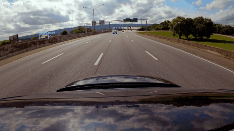

# Week 3: Classical Vehicle Motion Tracker

**Pipeline:** YOLO detection → Shi-Tomasi features → Lucas-Kanade optical flow
(forward-backward check, outlier rejection) → IoU re-association.
Camera motion is compensated with ORB + Lowe ratio test + RANSAC homography.

## Run
    pip install ultralytics opencv-python numpy pillow
    python video_processor.py

Edit the SETTINGS block at the top of `video_processor.py` (video, camera type, hood %, quality, preview).
